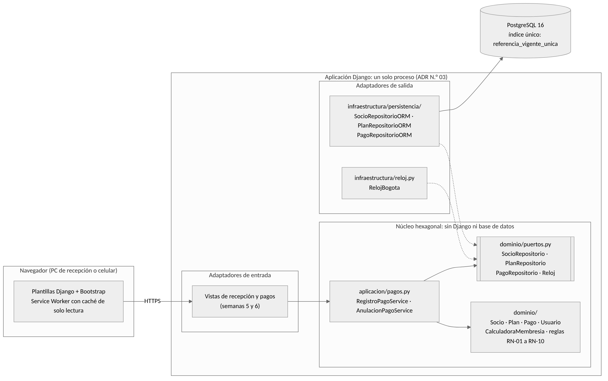

# Diagrama de componentes: núcleo, puertos y adaptadores (FPI-20)

Fuente editable: [`componentes.mmd`](componentes.mmd) (Mermaid). Las líneas punteadas indican que un adaptador implementa un puerto. Las pruebas de `tests/` implementan los mismos puertos con repositorios en memoria y un reloj fijo, y por eso el núcleo se prueba sin base de datos.

| Pieza | Carpeta | Puede importar | No puede importar |
| --- | --- | --- | --- |
| Dominio | `dominio/` | biblioteca estándar | `aplicacion`, `infraestructura`, `config`, Django, psycopg, SQLAlchemy, requests |
| Casos de uso | `aplicacion/` | `dominio` | `infraestructura`, `config`, Django, psycopg, SQLAlchemy, requests |
| Adaptadores | `infraestructura/` | `dominio`, Django, psycopg | — |
| Configuración | `config/` | Django | — |

La regla de dependencia la comprueba `tests/nucleo/test_arquitectura.py` en cada push.
