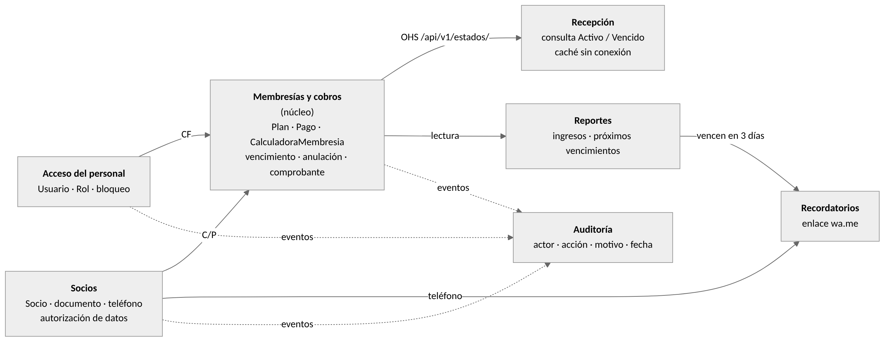

# Mapa de contextos delimitados (FPI-21)

Fuente editable: [`contextos.mmd`](contextos.mmd). Todos los contextos viven en el mismo monolito modular y en la misma base de datos (ADR N.° 05); los límites son lógicos.

| Contexto | Lenguaje propio | Estado en el código | Dueño de |
| --- | --- | --- | --- |
| Acceso del personal | usuario, rol, intento fallido, bloqueo | `UsuarioRepositorio` / `UsuarioRepositorioORM` (PR #2) | tabla `usuarios` |
| Socios | socio, tipo y número de documento, teléfono, autorización de datos | `Socio`, `NumeroDocumento`, `Telefono`, `SocioRepositorio` | tabla `socios` |
| Membresías y cobros (núcleo) | plan, pago, vencimiento, renovación anticipada, comprobante, anulación, estado de membresía | `Plan`, `Pago`, `CalculadoraMembresia`, casos de uso de `aplicacion/pagos.py` | tablas `planes` y `pagos` |
| Recepción | consulta, Activo / Vencido / Sin membresía, caché, sincronización | Diseñado (DAD, QA-02); se construye en las semanas 5 y 6 | caché del navegador |
| Reportes | ingresos por medio de pago, próximos vencimientos | Diseñado (RF-05) | vistas de solo lectura |
| Auditoría | evento, actor, acción, motivo | Diseñado (DAD) | tabla `auditoria` (solo inserción) |
| Recordatorios (Could) | recordatorio, enlace wa.me | Diseñado (RF-06) | — |

## Relaciones

| Relación | Tipo (DDD) | Qué significa en FitManage |
| --- | --- | --- |
| Socios → Membresías y cobros | Cliente-Proveedor (C/P) | Membresías pide el socio por tipo y número de documento; Socios decide cómo se valida. |
| Acceso → Membresías y cobros | Conformista (CF) | Membresías usa el `Rol` tal como lo define Acceso (por ejemplo, solo el administrador anula). |
| Membresías → Recepción | Servicio abierto (OHS) | Recepción consume el estado publicado en `/api/v1/estados/`, que es lo que guarda la caché sin conexión. |
| Membresías → Reportes | Modelo de lectura | Reportes solo lee pagos vigentes; nunca escribe en las tablas de cobros. |
| Socios, Acceso y Membresías → Auditoría | Eventos de dominio | `PagoRegistrado`, `PagoAnulado`, `SocioRegistrado` y `CuentaBloqueada`, publicados dentro de la misma transacción mientras todo esté en el monolito. |
| Reportes y Socios → Recordatorios | Lectura | Recordatorios toma los vencimientos y el teléfono para armar el enlace wa.me. |

## Fronteras que el código todavía cruza

- `Pago` guarda el objeto `Socio` completo y el `Usuario` completo. Dentro del monolito funciona, pero si algún contexto se separara, Membresías debería guardar solo `socio_id` y `usuario_id` (DT-12).
- Las tablas `pagos`, `socios` y `usuarios` están unidas por llaves foráneas. Se mantienen a propósito: son las que hacen cumplir QA-05 y la integridad del pago con su usuario en una sola transacción ACID.
