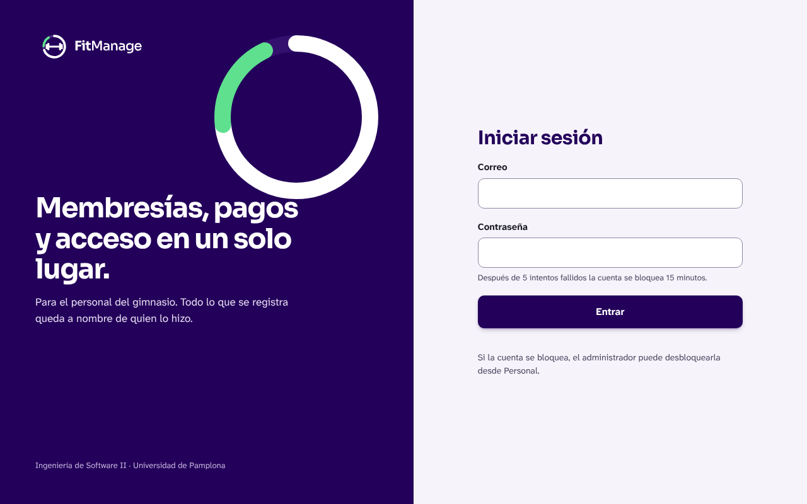
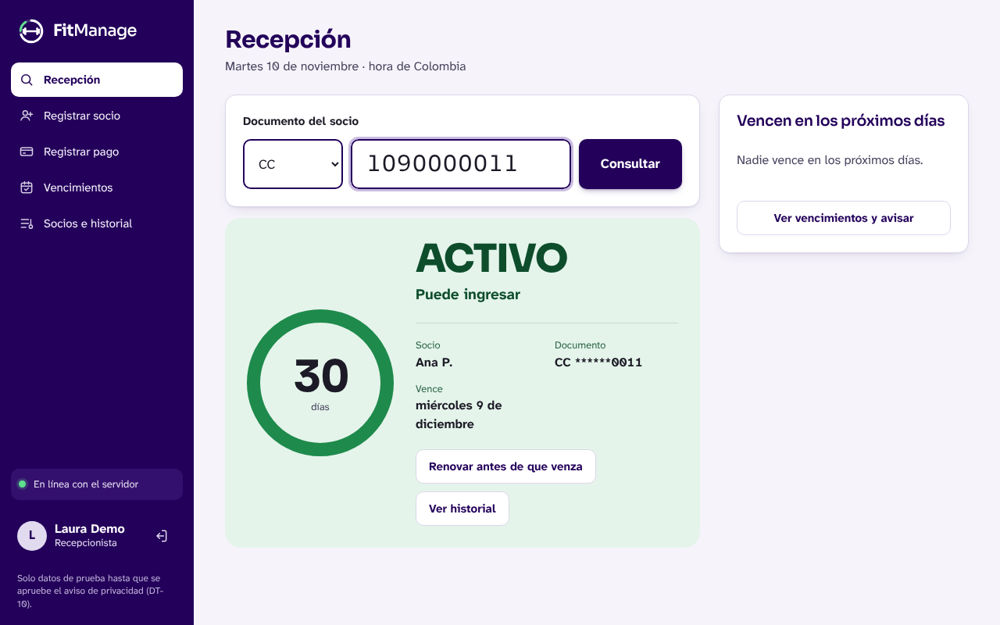
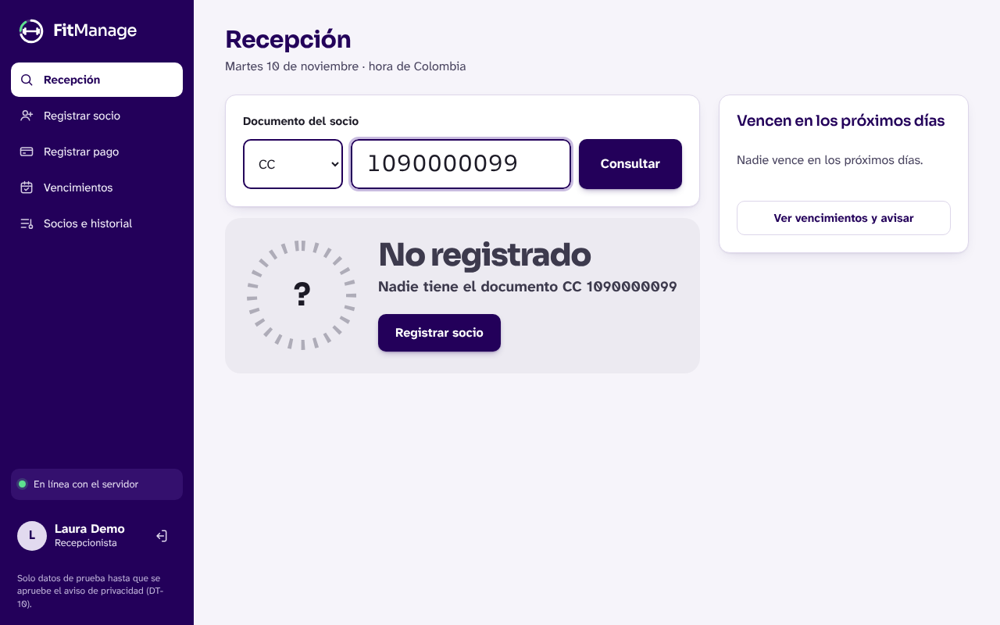
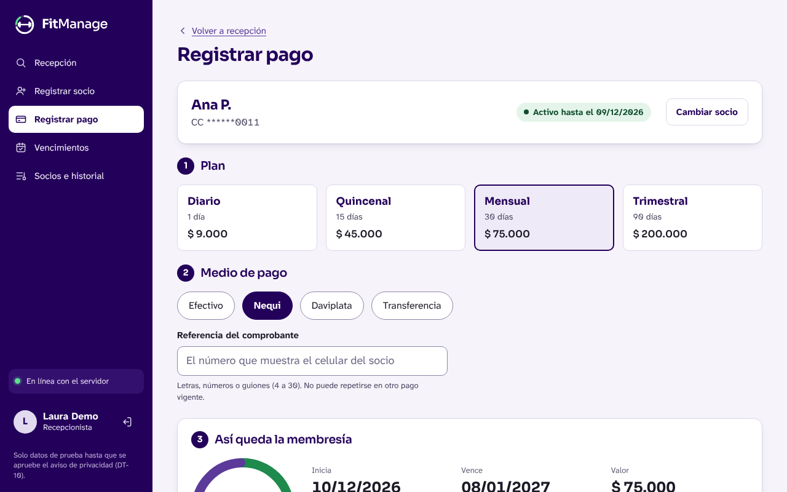
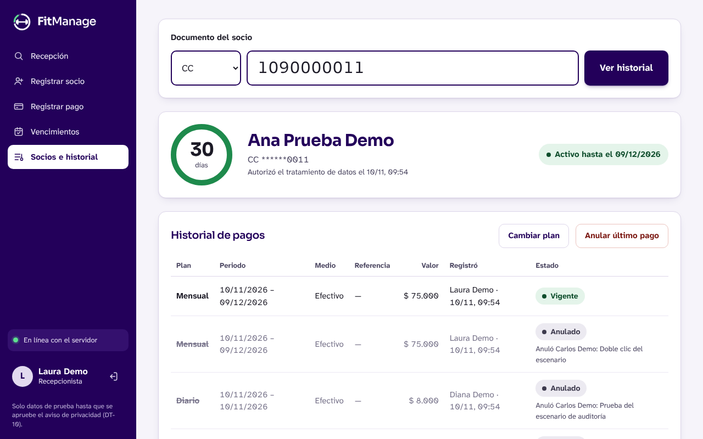
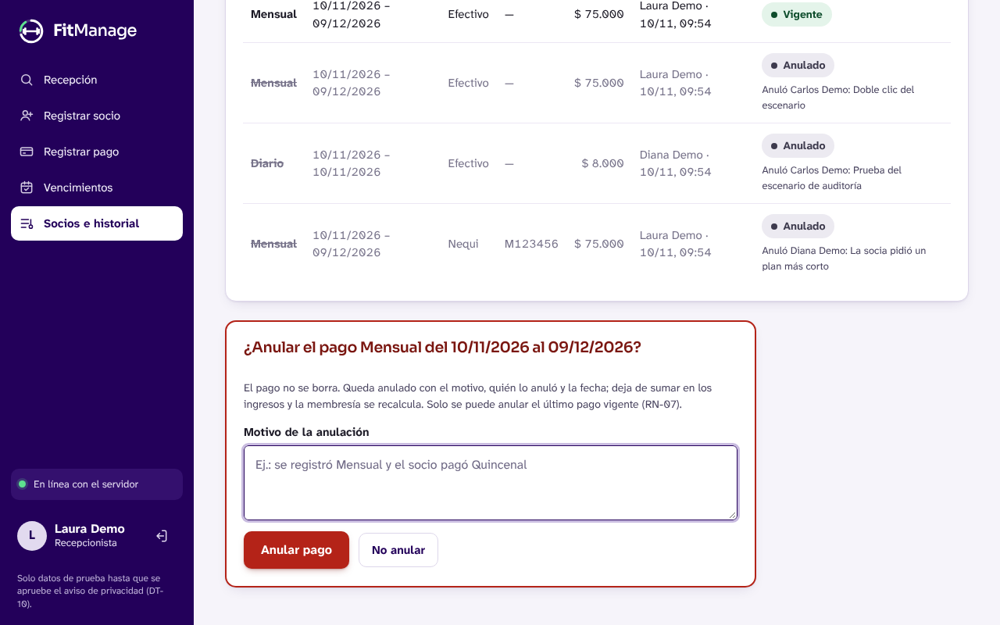
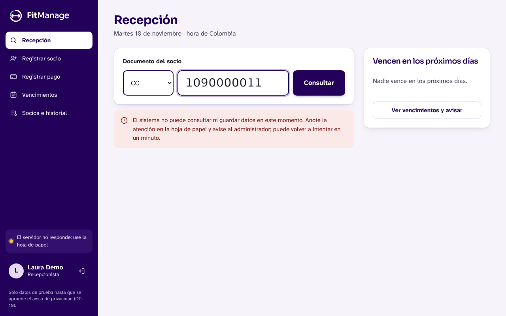

# Guía rápida de FitManage para la recepción

Guía II-06 · Versión del producto: la del commit que integra este archivo en `main` (v1.1.0 más las correcciones H-01 a H-03). Las capturas son de esa versión, con datos ficticios.

Esta guía es para la recepcionista. La última sección es para el administrador. Quien opera el servidor usa `docs/runbooks/Runbook_entrega.md`.

## Antes de empezar

- **Acceso:** el administrador le crea una cuenta con su correo y una contraseña de al menos 12 caracteres. La cuenta es personal: lo que usted registre queda a su nombre en la auditoría.
- **Necesita:** internet en el equipo de la recepción y la hoja de papel de contingencia a mano.
- **Datos:** mientras no exista el aviso de privacidad aprobado (DT-10), el sistema solo se usa con datos de prueba. Nunca escriba datos reales de un socio para practicar.

## 1. Saber si una persona puede pasar

1. En **Recepción**, escriba el número de documento y presione Enter.
2. Lea el resultado grande:
   - **ACTIVO · Puede ingresar**: pasa. Debajo dice hasta qué día. «Vence pronto» quiere decir que le quedan pocos días; puede recordárselo.
   - **VENCIDO · No puede ingresar sin pagar**: dice hace cuántos días venció.
   - **Sin membresía**: está registrado pero nunca ha pagado.
   - **No registrado**: nadie tiene ese documento. Revise el número; si es correcto, regístrelo como socio.

## 2. Cobrar un plan

1. Abra **Registrar pago** (o use el botón que aparece después de consultar).
2. Escriba el documento si no aparece el socio arriba.
3. Elija el plan y el medio de pago.
4. Si pagó por **Nequi, Daviplata o transferencia**, escriba la referencia que muestra el celular del socio. El sistema no deja usar dos veces la misma referencia en pagos vigentes.
5. Revise **Así queda la membresía**: muestra desde qué día y hasta qué día queda pagado. Si el socio todavía tenía días, el plan nuevo empieza cuando terminan.
6. Presione **Registrar pago de $ …**. Si el botón dice **Pago registrado**, quedó guardado. No lo presione otra vez.

## 3. Corregir un cobro equivocado

En **Socios e historial**, busque al socio. Tiene dos caminos:

- **Cambiar plan**: cuando el socio pagó, pero el plan era otro (por ejemplo, Quincenal y no Mensual). El pago anterior queda anulado con el motivo y se registra el nuevo en un solo paso.
- **Anular último pago**: cuando el cobro no debía existir. Escriba el motivo (al menos 5 caracteres).

Reglas que el sistema aplica: solo se anula el **último** pago vigente, y la recepcionista solo anula lo que ella misma registró **hoy**. Lo demás lo hace el administrador. Nada se borra: el pago anulado se sigue viendo tachado, con quién lo anuló y por qué.

> **Ojo con el dinero.** El sistema registra cobros; no maneja devoluciones. Si el plan correcto es más barato, la diferencia se devuelve por fuera del sistema, como se haga hoy en el gimnasio.

## 4. Si algo falla

| Lo que ve | Qué significa | Qué hacer |
| --- | --- | --- |
| «El sistema no puede consultar ni guardar datos en este momento…» y, en el menú, «El servidor no responde: use la hoja de papel» | El servidor o su base de datos no está atendiendo. | Anote en la hoja de papel documento, hora y, si cobró, plan, medio y referencia. Avise al administrador. Pruebe otra vez en un minuto. Cuando vuelva, registre lo anotado. |
| «No hay conexión con FitManage. Revise el internet de la recepción.» | El equipo de la recepción no tiene internet. | Revise el wifi o el cable. Mientras tanto, la hoja de papel. |
| «Comprobante duplicado» | Esa referencia ya está en otro pago vigente. | Pida al socio que le muestre el comprobante otra vez. Si es el mismo pago, ya estaba registrado: no lo cobre dos veces. |
| «Solo se puede anular el último pago vigente» | Hay un pago posterior. | Pida ayuda al administrador. |
| «Solo puede anular los pagos que usted registró hoy» | El pago es de otra persona o de otro día. | Pida ayuda al administrador. |
| «La sesión venció. Vuelva a iniciar sesión.» | Pasó mucho tiempo sin usar el sistema. | Entre de nuevo con su correo y contraseña. |
| La cuenta queda bloqueada | Cinco contraseñas equivocadas seguidas. | Espere 15 minutos o pida al administrador que la desbloquee. |

## 5. Dónde pedir ayuda

Escriba al responsable del soporte por el canal acordado al iniciar el piloto (ver `docs/piloto/plan_piloto.md`). Diga qué estaba haciendo, el documento de **prueba** que usó, la hora y el mensaje exacto. **Nunca** envíe su contraseña ni fotos de documentos reales.

## Para el administrador

- **Auditoría:** muestra quién registró, anuló o cambió pagos y planes, con la hora y el motivo, por periodos de hasta 31 días. Nadie puede borrar ni editar esos eventos.
- **Planes:** cambiar un precio solo afecta los pagos nuevos; lo ya pagado no cambia (RN-08). Debe quedar al menos un plan activo.
- **Personal:** crea cuentas y desbloquea las bloqueadas. Dé el rol de administrador solo a quien responda por el dinero del gimnasio.
- **Reportes:** ingresos por periodo y por medio de pago; los pagos anulados no suman.
